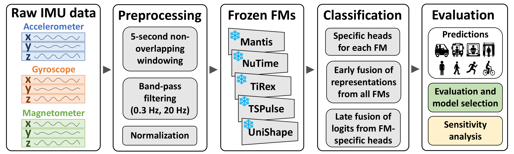

# SHL 2026: Frozen-Model Fusion

A paper companion for **Early and Late Fusion of Frozen Foundation Models for
IMU-Based Human Activity Recognition**, with a small Python reference
implementation of the selected weighted probability fusion.

**Mehdi Mohebbi, Ali Majlesi, Amir Basuti, Iraj Gharaee, Mohammad Mahdi Azizi,
Bagher BabaAli and Pouya Mohseni.** HASCA 2026 / UbiComp/ISWC 2026 Companion.
Status: **Accepted; DOI issued**. Indexing has not been confirmed here.

[Paper PDF](papers/shl-2026-frozen-model-fusion.pdf) ·
[DOI: 10.1145/3798063.3842618](https://doi.org/10.1145/3798063.3842618) ·
[Citation](CITATION.cff)



*Figure 1 from Mohebbi et al. (2026), CC BY 4.0. This overview shows the
alternatives studied; the selected weighted fusion below uses three nonzero
weights. See [asset attribution](ASSET_LICENSES.md).*

## What this companion provides

The paper studies five frozen foundation models: NuTime, Mantis, TiRex,
UniShape and TSPulse. Its selected linear probability fusion assigns:

| Model | Fixed weight |
|---|---:|
| NuTime | 0.54 |
| Mantis | 0.29 |
| TiRex | 0.17 |
| UniShape | 0.00 |
| TSPulse | 0.00 |

For each sample and class, this implementation computes
`p = 0.54 * p_NuTime + 0.29 * p_Mantis + 0.17 * p_TiRex`, then chooses the class
with the largest combined probability. The paper reports these weights in
Section 3.2 and defines probability-level linear fusion in Section 2.4.

The code in this repository is **newly written reference arithmetic**. It is
not the original competition training code, the complete paper pipeline, or a
reproduction of reported performance. It does not run the foundation models,
construct features, train heads, search for weights, calibrate probabilities or
compute accuracy/F1. UniShape and TSPulse require no input because their selected
weights are zero.

## Quickstart

No third-party Python packages are needed. Use Python 3.11 or newer. The local
release was tested on Python 3.14.3 on Windows. The included CI matrix runs on
Python 3.11–3.14 on Linux and Windows; see [Actions](https://github.com/AmirBasuti/shl2026-frozen-model-fusion/actions) for the current result.

```sh
python fusion.py --input examples/synthetic_probabilities.json --output fused_probabilities.json
```

The example contains **two invented probability rows**, not measured model
predictions. It produces the labels `Still` and `Bike` solely to demonstrate the
arithmetic. These labels are not predictions verified against ground truth, and
the example provides no performance result.

The output includes the fixed weights, class names, combined probabilities,
zero-based label indices and readable labels. An existing output file is refused
unless you explicitly pass `--force`:

```sh
python fusion.py --input examples/synthetic_probabilities.json --output fused_probabilities.json --force
```

Input and output must be different paths. The output parent directory must
already exist. Inputs are completely validated before opening an output file;
an interrupted write can still leave a partial output, so rerun after checking
the input and destination.

## Input contract

Provide one UTF-8 JSON object with exactly three keys: `NuTime`, `Mantis`, and
`TiRex`. Each value must be a nonempty `N × 8` array. A single sample looks like:

```json
{
  "NuTime": [[0.7, 0.1, 0.05, 0.05, 0.025, 0.025, 0.025, 0.025]],
  "Mantis": [[0.6, 0.2, 0.05, 0.05, 0.025, 0.025, 0.025, 0.025]],
  "TiRex": [[0.5, 0.3, 0.05, 0.05, 0.025, 0.025, 0.025, 0.025]]
}
```

This is another synthetic example. All models must have the same number of rows.
Columns must follow this exact order:

```text
Still, Walk, Run, Bike, Car, Bus, Train, Subway
```

Values must be numeric, finite and within `[0, 1]`. Booleans, strings, NaN,
infinity, duplicate model keys and unexpected model names are rejected. Every
row must sum to one within an absolute tolerance of `1e-6`; the program does
not silently normalize rows or apply softmax. If your model emits logits,
convert them to probabilities using the appropriate upstream pipeline first.

**Row alignment is the caller's responsibility.** Row `i` must describe the same
sample in every model. Shape validation cannot detect shuffled samples or an
incorrect class order. Tied maximum probabilities select the earliest class in
the stated order. Accepted rounding error is retained in the weighted result.

## Tests

```sh
python -B -m unittest discover -s tests -v
```

Sixteen tests check fixed weights and class order, soft probability arithmetic,
argmax labels and ties, input immutability, shape/count validation, invalid
numbers, normalization tolerance, malformed/duplicate-key JSON, the synthetic
example and explicit output overwrite behavior. These are software tests, not
scientific performance evaluation.

## Research scope

The companion includes the six-page author paper and a rendered overview figure.
The figure summarizes all study alternatives; it should not be read as evidence
that all five models have nonzero weight in the selected system.

Model selection and reported development results belong to the paper's stated
protocol. This repository adds no official hidden-test score, unseen-person
generalization claim, rank, robustness evidence or benchmark reproduction.
It includes no raw sensor data, participant identifiers, trained weights,
feature caches, teammate implementation or private research notes.

## Citation and licenses

Use [CITATION.cff](CITATION.cff) or [citation.bib](citation.bib) when citing the
study, preserving all seven authors. The preferred citation is the paper; the
small reference program is a separate companion implementation by Amir Basuti.

- **Original companion code and documentation:** [MIT](LICENSE).
- **Paper PDF and Figure 1 image:** [CC BY 4.0](https://creativecommons.org/licenses/by/4.0/),
  copyright retained by the paper's owners/authors. These assets are excluded
  from the MIT grant. Full attribution, source and modification status are in
  [ASSET_LICENSES.md](ASSET_LICENSES.md).

The supplied PDF is unchanged. Its SHA-256 is
`e24dfdd24a0d60699a43c7b377a07b85d79c24eae10f388a7d5738b264306d21`.
